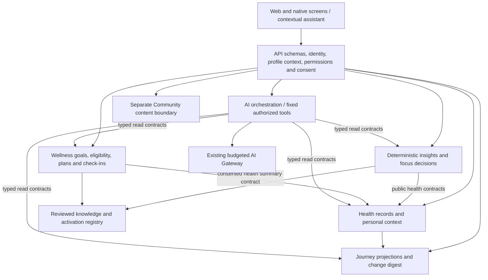

# Connected journey engine and data design

Target architecture for [the product blueprint](README.md), 22 October 2026. [Health Story 1](../../docs/engineering/HEALTH-STORY-1.md) implements the first factual context/timeline/digest contracts. Other contracts and migration decisions below remain proposed; the implementation record identifies the actual current APIs and limits.

## 1. One intelligence layer, several experiences

Keep the accepted TypeScript modular monolith, PostgreSQL, encrypted source-object storage and durable jobs. Add explicit application services rather than a second data platform. The phrase “health intelligence graph” describes typed relationships between versioned records; it does not justify a graph database or sending the whole database to an LLM.



Health owns evidence and reported context. Journey is a read/projection service, initially within Health. A proposed `modules/intelligence` owns relationship/priority decisions; `modules/knowledge` owns maintained definitions and activation records; `modules/wellness` owns behavior. Introduce separate modules only with explicit contracts and dependency-check registration. Existing Health comparability stays a pure tested domain function, callable through its public contract. Community cannot import private records or update clinical knowledge.

AI orchestration uses tool/Gateway contracts, with persistence injected through existing ports. Neither an agent nor a frontend imports another module's repository. Deterministic pages remain usable with AI disabled.

## 2. Four layers of truth

| Layer | Contains | Publication condition |
| --- | --- | --- |
| Original evidence | Immutable original files, page regions, raw extraction and metadata. | Authorized storage plus scanner/content pipeline state. |
| Confirmed facts and assertions | Verified laboratory facts; source-qualified manual/device/context assertions; documented instructions. | Identity/source checks and explicit confirmation appropriate to record type. |
| Derived understanding | Comparable cohorts, changes, focus membership, limitations and eligibility decisions. | Current input versions and an applicable active algorithm/knowledge policy. |
| Explanation and choice | Plain-language summaries, user priorities, accepted goals and action decisions. | Valid citations, context authorization and explicit acceptance for writes. |

A layer can reference the one below; it cannot silently rewrite it. “Confirmed against source,” “reported by caregiver,” “documented by clinician” and “clinically reviewed interpretation” are separate states, not a single `verified=true` flag.

## 3. Relational model extensions

Use named tables and typed constraints. A generic edges table may supplement traversal later, but must not replace foreign keys, ownership and entity-specific validation. Every profile-owned table has profile scoping, composite references where needed, RLS and application-policy checks matching existing patterns.

| Entity | Essential fields and constraints | Owner |
| --- | --- | --- |
| Existing source documents / observations | Reuse stable IDs, source field/page, comparator, original text/unit, report/observation revision, identity and verification history. | Health |
| Context assertion | Kind, original text/structured fields, source kind, asserted-by actor, authority, confirmation state, effective period/precision, recorded time, source refs, supersedes/disputed links. Prefer typed child tables for conditions, medications, allergies and restrictions. | Health |
| Manual measurement | Concept as confirmed, original value/unit, method/device context, observed time/precision, reporter, provenance, revision. Reuse the observation contract where valid; do not create a fake scanned report/page. | Health |
| Documented instruction | Verbatim instruction/source, author as documented, effective dates, optional follow-up, status, attribution and explicit replacement relationship. | Health |
| Journey event projection | Kind, entity/version refs, effective date/range/precision, recorded date, display status, dependency manifest, projection generation. Not an independent medical source. | Health/Journey |
| Knowledge definition/version | Typed purpose, source references, applicability, evidence tier, limitations, review/expiry metadata, content checksum and immutable definition. | Knowledge |
| Knowledge review/activation | Reviewer authority and decision, approved version, scope, activation/withdrawal/expiry events, reason, timestamps. Approval and activation are separate. | Knowledge |
| Focus definition and membership | Approved definition/version, evidence/context members, relationship kind, inclusion/exclusion rationale, applicable temporal scope and input revisions. | Intelligence |
| Insight/decision | Typed claim/decision, supporting and contrary evidence, missing inputs, rule/content versions, input manifest, explanation data and current/stale/superseded state. | Intelligence |
| Priority item and actor state | Category, reason, source decision, action target, user-selected order where allowed, acknowledgement/snooze. Actor read state is separate from profile fact state. | Intelligence/Journey |
| Goal and accepted action | Goal owner/subject, measurable intent, target if user-specified, action/catalogue version, variants, cue, burden, acceptance actor/time, lifecycle and revisions. | Wellness |
| Eligibility decision | Candidate, evaluated context snapshot, allowed/blocked/unknown/not-evaluated result, individual check outcomes, policy versions and reasons. | Wellness |
| Opportunity and check-in | Stable scheduled opportunity, plan version, local time/timezone, completion variant, reported outcome, reporter, source, missingness and revisions. | Wellness |
| Actor review checkpoint | Actor + profile, reviewed-through event watermark, explicit period preference; bounded by current permission. | Journey |

Do not use a medication's display string as its ingredient code or assume a parsed brand resolves identically in India/UAE. Preserve the original and keep uncertain terminology mappings unconfirmed. Allergy records must not become arbitrary condition strings that bypass later action checks.

### Dates and historical validity

Retain at least: occurrence/effective time, assertion time, source issue time, app ingestion time and revision time where relevant. Support date-only, precise instant, interval and unknown precision. Never replace an unknown clinical date with upload time. Preserve original timezone/precision; display local scheduling time separately from the AI budget day.

An association with medication use must evaluate whether the assertion actually covers the observation period. An uncertain start date cannot prove exposure at a past test. Current action eligibility uses current context, which may differ from context at the time of a historical result.

HL7's distinction between effective and issued observation time is a useful reference for this separation. [Observation definitions](https://hl7.org/fhir/R5/observation-definitions.html) support this model; formal FHIR import/export profiles remain a later integration design.

### Data lifecycle

Continue append-only corrections for evidence integrity. Projections are rebuildable and can be replaced; authoritative revisions are retained under an explicitly defined retention policy. The existing immutable-table triggers mean erasure cannot be implemented as a casual DELETE endpoint. Design a separately privileged, audited subject-erasure/key lifecycle and backup-expiry process before promising deletion behavior. Define retention exceptions with the jurisdiction review; append-only is not permission for indefinite retention.

Assess encryption for new structured context, free text, projections, search indexes and backups against the existing database threat model. Encrypted objects/chats do not by themselves prove every new database column or index is encrypted. Do not place medical payloads in traces, cache keys, job names, URLs or analytics events.

## 4. Typed relationships and their meaning

| Relationship | Permitted meaning | Must not imply |
| --- | --- | --- |
| `derived_from` | This version was produced from the cited source/version. | Clinical correctness just because extraction succeeded. |
| `supersedes` / `amends` | An explicit correction/replacement relationship with scoped provenance. | Every result in a newer report replaces the older report. |
| `supports_focus` | Evidence belongs in a reviewed organizational focus under the cited definition. | The person has a diagnosis or quantified disease risk. |
| `context_for` | A reported/documented fact is relevant within a specified period. | Causation or complete clinical context. |
| `potential_target_of` | Reviewed knowledge links an action to a possible objective. | A guaranteed individual benefit. |
| `constrained_by` | A policy evaluated a relevant known restriction or unresolved input. | A comprehensive medication/condition interaction clearance. |
| `measured_by` | A behavior or outcome measure is relevant to revisiting the goal. | A later laboratory change was caused by that action. |

Each computed relationship needs input entity versions, applicable knowledge/policy version, rationale, effective scope and a lifecycle state. Arbitrary model-generated edges are draft suggestions at most. User-created collections are explicitly organizational and cannot authorize a clinical interpretation.

Avoid a single opaque confidence percentage. Present separate dimensions: identity resolved, source confirmed, timing known, comparable context complete, knowledge applicable/current, missing personal context and checks not performed. An OCR confidence and a clinical-evidence grade are unrelated measures.

## 5. Knowledge and clinical-rule lifecycle

Existing `health_rule_versions` supports normalization, aggregation and comparability, with immutable records. It does not supply a general medical knowledge engine. Add a separate typed registry for concept/anatomy mappings, focus relationships, interpretation, action content, eligibility and any interaction/attention policies. Do not squeeze those into an existing purpose or mutate immutable approval rows.

Proposed lifecycle:

```text
Draft version → evidence/applicability review → approved version
    → explicitly activated for scope → superseded / withdrawn / expired
```

Reviews and activations are append-only events with authorized reviewer/operator identities. The latest applicable activation projection determines whether a version can be used; a populated reviewer-name string is not proof of review. Builder, reviewer and activation actor responsibilities must be explicit. No synthetic review record can make content active for real participants.

Every version records sources, review date/due date, supported population/context, exclusions, known limitations, test fixtures, owner, license/usage rights and rollback plan. Definitions and tests are reproducible. Review a small maintained set first; deactivate content whose applicability or maintenance is unresolved.

Medication interaction support is its own future capability: licensed/authorized maintained knowledge, ingredient/product reconciliation, contextual applicability, explicit severity/action semantics and independent evaluation. Overlap of two medication names is not interaction checking. Until these exist, preserve **Not evaluated** rather than an invented all-clear. General source-linked medication recording can ship independently.

No live open-web retrieval is trusted clinical knowledge by default. An editorial import/review workflow promotes a specific sourced version. Community posts and clinician-letter OCR cannot directly update policy. Personal care instructions remain individual source records, not universal rules.

## 6. Deterministic processing pipeline

1. Resolve actor, selected profile/revision, grants, purpose-specific consent and permitted data classes.
2. Load a consistent snapshot of current effective facts, confirmed context, source states and applicable active knowledge.
3. Construct the timeline using effective dates and explicit unknown lanes. Preserve issue/upload/revision history separately.
4. Run existing exact comparability. Keep distinct results and visible exclusions. No new unit conversions, aggregation or health scores are activated by this project.
5. Compute factual differences using decimal-safe amounts and exact dates; handle zero denominators and comparator/qualitative exclusions. Label pairwise change separately from an observed sequence or any evaluated statistical method.
6. Apply only active approved mappings/relationship rules. Record supporting inputs, limitations, contrary inputs and applicability failures.
7. Produce workflow priorities and user priorities through explicit policies. Clinical attention policies, if introduced later, remain separately reviewed and evaluated.
8. For an action request, evaluate active content + health-to-wellness permission/consent + required context + exclusions + instructions + preferences/burden. Unknown is an output, not a reason to guess.
9. Store the decision with an input manifest. Return a projection generation and display reasons. AI can explain this result but cannot change its eligibility or factual basis.

### Priority policy

Within record tasks, order by explicit workflow blocking dependencies and user choice. Within accepted tasks, use the recorded due date/selection and expose the basis. Support snooze without changing the evidence or deleting the task. Do not create a composite medical risk score from record volume, out-of-range count or missingness.

A future medical attention pathway needs its own intended use, thresholds, symptom policy, human escalation, response-time limits and evaluation. Do not imply that absence of a displayed alert means absence of urgent illness. This blueprint defines no medical thresholds.

### Action eligibility and impact

The action decision exposes each evaluated check: pass, blocked, unknown or not applicable, with its source/policy. Its overall result cannot be eligible when a required safety-relevant input is unknown or a relevant active instruction conflicts. The result lists what was not checked and its scope.

Ranking applies only to eligible candidates, using user goal, preference, opportunity, accessibility and burden. Recommendation generation cannot overrule eligibility. Variants have independently reviewed applicability; a fallback is not automatically safe because it is shorter.

Progress is calculated from stable opportunity IDs and the plan version effective at each opportunity. Completed, partial, excused/paused and unreported counts are separate. Shared actions are deduplicated when calculating burden. Dates and denominator rules are inspectable. No background adaptation silently modifies an accepted schedule.

## 7. Events, invalidation and consistency

Reuse the transactional outbox and bounded workers. Proposed events include observation corrected/withdrawn, context revised, instruction superseded, consent/grant changed, knowledge activated/retired, plan accepted/revised and check-in recorded. These are sanitized identifiers/revisions, not medical text in event names or operational logs.

**Do not rely on a worker to revoke trust.** A source or policy change transaction also advances the relevant domain generation/invalidation watermark. Every derived read checks its dependency manifest or watermark. A worker rebuilds projections asynchronously, with replay-safe idempotency and bounded retries, but stale insights cannot remain current while it catches up.

Keep UI selection revision separate from domain evidence/knowledge/plan revisions. One tracks which person is selected; the others track what is true or applicable. A read envelope can contain:

```text
schemaVersion
profileContext { profileId, selectionRevision }
snapshot { evidenceGeneration, knowledgeGeneration, planRevision? }
data
dependencies [{ entityType, entityId, revision }]
availability { current | recomputing | unavailable, reasonCodes[] }
```

After a correction: effective facts change; the previous insight loses current status; Dashboard/timeline display a record update or rebuilding state; eligibility is reevaluated; old AI answers are withheld/marked stale per the existing behavior. Existing prescribed care is preserved as a record. Re-evaluation may suspend app coaching but must not advise stopping treatment.

On knowledge withdrawal, the source facts remain valid while affected interpretations/actions lose applicability. On grant revocation, access checks deny immediately according to transaction ordering; the client clears on access-denial/invalidation and must not publish an old response. Define and test a bounded refresh/invalidation mechanism for an already-open idle screen rather than claiming server revocation can erase previously viewed information instantaneously.

On profile switch, synchronous clearing/cancellation remains mandatory. On consent withdrawal, purge the relevant derived/AI context and queued dispatches under that purpose. Cache keys include actor authorization scope and profile; never share a private summary just because two profiles have similar records. Recheck authorization on cache retrieval and response delivery.

## 8. API and AI tool evolution

Preserve current `/v1` clients. Use versioned schemas and additive endpoints for compatible additions; introduce a versioned route/contract for breaking answer or permission semantics. The exact paths are to be finalized in the first implementation ADR.

| Proposed service interface | Scope and behavior |
| --- | --- |
| Journey read / change digest | Cursor pagination, date precision, event filters, explicit actor checkpoint and projection generation. |
| Context list/create/revise | Kind-specific schemas, provenance/authority, expected revision and idempotency. No diagnosis inference. |
| Manual measurement create/revise | Typed value/context, genuine manual source and immutable revision lineage. |
| Focus/insight read | Explainable membership, exclusions, knowledge versions and currentness. |
| Priority acknowledge/snooze | Actor state separate from shared evidence; no clinical-state mutation. |
| Action eligibility preview | Candidate and required-context checks; preview is not acceptance. |
| Goal/plan accept/revise/pause | Current eligibility, user confirmation, expected revisions and prospective schedule changes. |
| Check-in create/revise | Stable opportunity, selected outcome/variant, source and reporter. |
| Reviewed knowledge administration | Separate privileged role, review/activation history and rollback; unavailable to ordinary profile actors and AI. |

All private operations use the existing profile policy. Health-to-wellness reads require the existing `health_to_wellness` consent and appropriate health/wellness scopes. Model use additionally checks `health_ai` and/or `wellness_ai` for the data being sent. Existing consent-purpose names are not proof that all new flows have been implemented or consented. Version the notice to describe new context classes before activation.

Proposed read tools are `journey_summary`, `health_context`, `focus_evidence`, `priority_reasons`, `action_eligibility` and `plan_progress`, alongside existing report/observation/compare tools. Tools accept bounded identifiers/filters, not SQL, arbitrary URLs or code. Grant filtering can withhold particular kinds of context without implying “none.”

### Versioned explanation contract

The current `ExplanationSchema` permits summary/limitation cards with observation ID/revision citations. Future explanations need a strict tagged citation union: observation, context assertion, documented instruction, knowledge version, insight decision or plan version. Each citation is resolved against the authorized current tool result; external URLs come from reviewed knowledge metadata, not a model-generated string.

Validate schema, referential validity, claim-to-source support, applicability, content policy, mixed-profile references and currentness. Correct citation IDs do not prove that a sentence is entailed. Use deterministic phrasing where necessary and clinically reviewed evaluation for free-form health explanations. Do not delegate the final authorization or action safety verdict to another LLM.

Retain configured model/key/prices, `store:false`, bounded context/tokens/deadlines, atomic reservations and the US$5 app-wide daily ceiling resetting at midnight Asia/Kolkata. No model/pricing choice is assumed by this plan. On-demand generation and deterministic fallbacks are preferable to automatic paid summaries on every event. Any reusable answer cache must be purpose-, authorization-, subject- and dependency-scoped, with fresh checks at retrieval and delivery.

## 9. Deployment and migration strategy

Use forward-only migrations after the current sequence; determine migration numbers from the repository when implementation starts. Preserve stable profile/report/observation IDs and existing clients. Build timeline projections from current effective records without fabricating absent dates, clinicians, medication histories or approvals. Backfills are idempotent, profile-scoped and resumable.

Ship behind separate capabilities: factual journey, context capture, reviewed focus mappings, priority policy, manual goals, reviewed actions, AI context extension, reviewed education and moderated posting. A flag is an additional control; the domain must still enforce authorization and active knowledge status.

Use existing local pilot services first. Re-run backup/restore with new context, knowledge versions, goals, dependencies and keys before pilot expansion. Hosted infrastructure, external provider retention/residency, new device connectors, notification delivery and public moderation each need their own operational decision and evidence.
