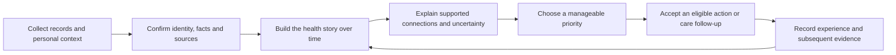

# BiovitAI connected health journey — product experience blueprint

Prepared 22 October 2026. Product blueprint with incremental implementation. **Health Story 1 (CJ-001–CJ-004)** is implemented; see [its engineering evidence](../../docs/engineering/HEALTH-STORY-1.md). Other designs remain proposed unless the separate connected-journey tracker says otherwise. This blueprint does not approve clinical content, change the original 51 product tasks, or claim participant validation.

## Product direction

BiovitAI should help a person answer: **What do we know about my health, what has changed, what should I pay attention to, what can I realistically do, and what happened afterwards?**

The product connects medical history and daily wellbeing through one continuous journey:

The proposed **Connected Health Journey Engine** supplies this continuity. It is a set of typed domain services and relational projections, not a new chatbot, autonomous doctor, or requirement to install a graph database.

The visual BioFlow system stays. The next change is to the purpose and content of each experience. A component earns space when it helps someone understand, organize, decide, act or revisit an earlier decision.

## Read this package

| Document | Design decisions it contains |
| --- | --- |
| [Module designs](MODULE-DESIGNS.md) | Page ownership, content hierarchy, detailed flows, states, family behavior and acceptance for every product module. |
| [Intelligence and data](INTELLIGENCE-AND-DATA.md) | Typed evidence relationships, knowledge governance, priority decisions, action eligibility, data contracts, revisions, AI and invalidation. |
| [Delivery and acceptance](DELIVERY-AND-ACCEPTANCE.md) | Dependency-ordered vertical slices, proposed epics, concrete demonstrations, evaluation, launch gates and unresolved decisions. |

## First audience and outcome

The first design lens is an adult with several years of records and a family caregiver helping organize them. This is a planning assumption suggested by the supplied examples, not a new age-policy approval. Minor/guardian handling remains unresolved.

Design for three jobs:

1. **The person:** “Help me understand my situation without making me learn laboratory terminology.”
2. **The caregiver:** “Help me prepare an accurate picture for this person and remember the next agreed step.”
3. **The returning user:** “Tell me what changed and help me resume where I left off.”

A first successful session ends with an understandable sourced history and one useful next step. A successful return shows what changed, what is still unknown and whether the chosen step remains appropriate. App openings and the number of generated insights are secondary metrics.

## Each destination owns a different question

| Destination | User question | Owns | Connects to |
| --- | --- | --- | --- |
| Dashboard | What matters to me now? | A short change digest and manageable next steps. | Timeline, source review, focus details, active action. |
| My Health | What is my complete health story? | Timeline, measurements, conditions as recorded, medications as reported, clinician guidance and personal context. | Original sources and Insights. |
| Insights | What can I understand from this evidence? | Comparability, changes, supported relationships, limitations, focus areas and discussion preparation. | Source facts and eligible action choices. |
| Labs & Reports | Where did this information come from? | Document lifecycle, identity, verification, corrections and provenance. | Published facts and their timeline events. |
| My Wellness | What can I realistically do, and how is it going? | User goals, eligible actions, check-ins, adaptation, recovery and behavior progress. | Focus area rationale and subsequent evidence. |
| Community & Trends | What reliable information or experiences can I learn from? | Reviewed education first; separately moderated participation later. | Public sources; explicit private “save a question” action where authorized. |
| Assistant | Help me understand this, here. | Plain-language explanation and navigation over the same authorized records and services. | The originating result, focus, instruction or plan. |
| Profile and privacy controls | Whose information is this, and who can use it? | Subject selection, grants, consent, contact linking and preferences. | Every private destination. |

Counts belong mainly in the report library and supporting detail. The Dashboard should gradually give its primary space to a change digest rather than repeating five administrative metrics. My Health owns the full timeline; Insights owns the analysis of that timeline. The assistant explains both without creating a third version of the person's health record.

## Shared language for all screens

Every important statement has one of four meanings, displayed in plain language:

| Meaning | Example form | Required support |
| --- | --- | --- |
| Recorded fact | “This report contains this value on this date.” | Verified source or explicitly labeled manual/device record. |
| Personal context | “You reported taking this medication.” | Reporter, assertion date, effective dates and confirmation status. |
| Interpretation | “These records may be relevant to a shared focus area.” | Applicable approved knowledge/rule, evidence links and limitations. |
| Agreed action | “You chose this action for this goal.” | User acceptance, eligibility decision and action/plan version. |

“Verified” means checked against a record or approved workflow; it must not imply clinician assessment. “Unknown” is different from “none.” “Not assessed” is different from “healthy.” A laboratory reference interval is different from a diagnosis or individual target.

All four meanings can appear together in an insight, but their sources and authority stay distinct. Uncertainty is presented where it affects a decision, not hidden in a generic footer.

## Current implementation versus proposed capability

Source baseline inspected at `5da0d553c2a0df00d0119ae10605800b24811176`. Prior executed evidence is in [the BioFlow refinement record](../design-system/BIOFLOW-REFINEMENTS-2026-10-22.md) and [P2–P5 implementation record](../../docs/engineering/P2-P5-IMPLEMENTATION.md). Those are historical engineering results, not new tests performed while writing this plan.

| Capability | Current source | Design gap |
| --- | --- | --- |
| Accounts, email-less family profiles, contact updates, grants and active context | Implemented with permission/revision guards. | Guided onboarding and permission-aware health/wellness context capture. |
| Encrypted reports, local scanning/OCR, identity and verification | Implemented, with explicit unavailable/failure states. | Document classification beyond lab reports, guided bulk onboarding and easier review prioritization. |
| Verified observations, revisions and source pages | Implemented. | Manual/device measurements and typed non-laboratory context. |
| Comparisons and trends | Exact verified context only; no normalization or averaging. | Better change explanations and approved relationship knowledge. |
| Anatomical view | Neutral pointers; all organ interpretations not assessed. | Separate evidence coverage and explicitly defined behavior-progress modes. |
| AI | Authorized report/observation/analysis tools and bounded Gateway. Live configuration remains unavailable. | Contextual questions, broader typed citations and confirmed-write proposals. |
| Health story | Health Story 1 now supplies the unified timeline, source-qualified context, corrections and change digest. | Broader contextual AI and reviewed relationship interpretation remain later increments. |
| Focus areas, priority queue and action impact | Not implemented as connected domain capabilities. | New services, definitions, review lifecycle and user experience. |
| Wellness | Unavailable-state presentation. | The previously proposed P6 goal/action/check-in/recovery services. |
| Community | Read-only/paused empty presentation. | Reviewed content operations first, then any staffed moderation capability. |

Existing schemas already preserve original values, observation/report timing, source regions and correction history. Extend them; do not migrate everything into an untyped “health memory.”

## Product decisions recommended by this blueprint

- Build the **health story and personal-context foundation before personalized recommendations**.
- Introduce connected focus areas as a way to organize evidence, not as inferred diagnoses or organ-health scores.
- Separate workflow priorities, user priorities and any future reviewed clinical attention policy. Never let a general ranking algorithm imply medical urgency.
- Give each accepted action an explainable target, eligibility result, burden and progress measure. Reuse one action across goals where appropriate instead of prescribing duplicate tasks.
- Use deterministic services for facts, comparisons, applicability and safety decisions; use AI to explain the returned evidence and choices.
- Begin with a small, reviewed content set that can be maintained. Do not promise comprehensive medication-interaction checking through an LLM.
- Keep Community behind the core journey in delivery priority. Education is useful sooner than a new social feed.

## Cross-module experience standards

**Progressive disclosure:** show a short explanation first, then exact values and dates, then provenance/rules. Preserve an obvious route back. An older adult should not need to interpret a chart to complete the primary task.

**Family context:** keep the avatar and selected name visible; name the subject again on record creation, accepting an action and sharing. Record both the person whose data is stored and the actor who entered it. A caregiver's observation is labeled accordingly. Family membership does not imply permission or biological family history.

**Accessible continuity:** use the current responsive web shell and three native tabs. Focused Reports, Insights and timeline routes sit within native My Health. Support screen readers, large text, keyboard/back navigation, low-literacy summaries and reduced motion. Colors distinguish categories and states; text explains them.

**Trustworthy emptiness:** missing information is a reason to offer a useful next step, not to manufacture a score. “No blood-pressure record in this app” must not become “you need a test” or “your blood pressure is normal.”

**User control:** draft, accept, pause, edit, decline and revisit are first-class actions. Sensitive context is optional, but declining information can leave a recommendation unevaluable. Explain that relationship without coercion.

**Corrections:** changes to an underlying fact must reach the timeline, insights, Dashboard, action eligibility and assistant. A changed summary never silently changes a source or cancels a prescribed treatment.

## Scope and review posture

Keep the confirmed local PostgreSQL pilot, English delivery, India/UAE market intent, local OCR, Android-first validation, iOS-compatible source and US$5/day app-wide AI budget. Cross-border arrangements and jurisdiction-specific intended-use/claims assessment remain unresolved.

The owner has deferred reviewer appointments. That does not block design, synthetic fixtures, source organization, manual context capture or user-controlled tracking. Clinical relationship rules, contraindication rules, individualized medical guidance and reviewed wellness content stay inactive until their actual review/activation requirements are met. This plan does not invent reviewer signoff or require a new approval before planning can continue.

P6/P7 were outside the previous implementation delivery. They are now designed here as future work; the application is not represented as already providing them.

## Basis and external references

The two owner-supplied vision notes are the primary product input. Local v2.1 requirements [01](../BiovitAI-Documentation-v2.1/requirements/01-PRODUCT-VISION-AND-SCOPE.md), [13](../BiovitAI-Documentation-v2.1/requirements/13-LIFESTYLE-PLANS-AND-PROGRESS.md), [45](../BiovitAI-Documentation-v2.1/requirements/45-WELLNESS-BEHAVIOR-CHANGE-ENGINE.md), [46](../BiovitAI-Documentation-v2.1/requirements/46-COMMUNITY-AND-MEDICAL-TRENDS.md), [47](../BiovitAI-Documentation-v2.1/requirements/47-MODULAR-ARCHITECTURE-AND-BOUNDARIES.md) and [53](../BiovitAI-Documentation-v2.1/requirements/53-TESTING-EVALUATION-AND-OUTCOMES.md) supply existing constraints. This package extends their experience detail without altering the archived baseline or approval records.

External sources checked while planning:

- [HL7 FHIR R5 Observation](https://hl7.org/fhir/R5/observation-definitions.html) separates the time relevant to a measurement from the time its version was issued. Our proposed timeline retains that distinction and also preserves upload time.
- [HL7 FHIR R5 Condition](https://hl7.org/fhir/R5/condition.html) and [MedicationStatement](https://hl7.org/fhir/R5/medicationstatement.html) support keeping condition assertions and reported medication use separate from laboratory measurements and prescribing events. These inform the domain distinctions, not a claim that BiovitAI is a conformant FHIR server.
- [HL7 FHIR R5 Provenance](https://hl7.org/fhir/R5/provenance.html) provides a useful reference for version-linked records of who and what produced a fact. The application should preserve source lineage separately from access audit.
- [WHO health-AI ethics guidance](https://www.who.int/publications/i/item/9789240029200) informs transparency, autonomy and accountability. [WHO regulatory considerations](https://www.who.int/publications/i/item/9789240078871) discusses evaluation and monitoring at a high level; it is not a jurisdiction-specific regulatory framework or authorization.

The specific module design, ranking rules, delivery slices and proposed evaluation targets below are our product/engineering proposals, not clinical recommendations supplied by these references.
